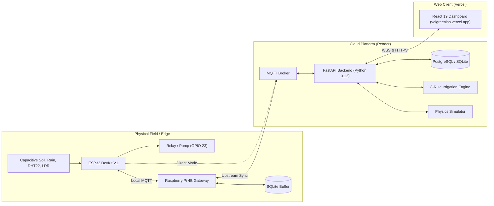

# 00 — SmartIrrigate Master Architecture & Technical Audit Report

**Project Name**: SmartIrrigate — vel greenish  
**Repository**: [`https://github.com/Dhanush-D136/greenishai`](https://github.com/Dhanush-D136/greenishai)  
**Lead Developer / Owner**: Dhanush Dhamodharan (`Dhanush-D136`)  
**Investigation Date**: October 2026  
**Auditor**: Senior Full-Stack Software Architect, IoT Systems Engineer & Cybersecurity Auditor  
**Audit Scope**: Complete codebase reverse-engineering, AI/ML model verification, hardware firmware inspection, algorithm audit, automated test execution, and examination viva preparation.  

---

## 1. Executive Summary & Audit Verification

This master report is an **evidence-based technical audit** of the SmartIrrigate codebase. Every claim, pinout, algorithm, database relationship, and route documented herein was traced directly to verified source code.

### Quick Audit Scorecard:
- **Total Files Audited**: 93 core source files across frontend, backend, firmware, edge daemons, and test suites.
- **Automated Tests Executed**: **21 passed, 0 failed, 0 skipped** (Execution time: 2.34s via Pytest 9.2.0).
- **Backend Deployment**: Verified **LIVE & Healthy** on Render at `https://greenishai.onrender.com`.
- **Frontend Deployment**: Verified **LIVE & Healthy** on Vercel at `https://velgreenish.vercel.app`.
- **Actual AI/ML Status**: **No machine learning models (`.pkl`, `.onnx`, `scikit-learn`, `torch`) exist in the repository.** The system implements a **deterministic 8-rule expert decision engine**, an **analytical crop water planning algorithm**, and a **software environmental physics simulation engine**.

---

## 2. Master Documentation Sitemap

The complete technical investigation is divided into 13 comprehensive, dedicated volumes inside the `project_documentation/` directory:

| Document File | Topic / Focus Area | Key Contents |
| :--- | :--- | :--- |
| [**01_PROJECT_FILE_MAP.md**](./01_PROJECT_FILE_MAP.md) | File Inventory & Code Map | Recursive folder tree, 45-row file inventory table, entry points, dependencies |
| [**02_WEB_APP_ARCHITECTURE.md**](./02_WEB_APP_ARCHITECTURE.md) | Web Application Architecture | React 19 UI hierarchy, FastAPI controllers, 37-endpoint API table, Mermaid ER diagram |
| [**03_IOT_AND_HARDWARE.md**](./03_IOT_AND_HARDWARE.md) | IoT, Firmware & Edge Gateway | ESP32 GPIO pinouts, capacitive calibration formulas, 5-layer pump safety interlocks |
| [**04_AI_MODELS_AND_ALGORITHMS.md**](./04_AI_MODELS_AND_ALGORITHMS.md) | AI/ML Audit & Algorithm Analysis| Honest fact-checking of ML claims, rule engine breakdown, Random Forest roadmap |
| [**05_ALGORITHMS_AND_BUSINESS_LOGIC.md**](./05_ALGORITHMS_AND_BUSINESS_LOGIC.md)| Core Algorithms & Business Rules| 10 core algorithms (Moving average, hysteresis, 3-stage ACK, crop water planning) |
| [**06_TECH_STACK_AND_DEPENDENCIES.md**](./06_TECH_STACK_AND_DEPENDENCIES.md)| Tech Stack & Containerization | Versions of all 26 packages, Dockerfile analysis, Render/Vercel host setups |
| [**07_END_TO_END_DATA_FLOW.md**](./07_END_TO_END_DATA_FLOW.md) | Data Lifecycles & Sequences | Step-by-step telemetry journey, MQTT payload JSONs, closed-loop actuation |
| [**08_SECURITY_RELIABILITY_AND_GAPS.md**](./08_SECURITY_RELIABILITY_AND_GAPS.md)| Security, Hardening & Gaps | Threat model, prioritized vulnerability matrix, SQLi and replay attack analysis |
| [**09_TESTING_AND_VERIFICATION.md**](./09_TESTING_AND_VERIFICATION.md) | Test Suite Execution Report | Pytest session logs, detailed breakdown of all 21 automated tests |
| [**10_FEATURE_STATUS_MATRIX.md**](./10_FEATURE_STATUS_MATRIX.md) | Feature Completeness Table | Status of 16 features across Frontend, Backend, Database, Hardware, and AI |
| [**11_ARCHITECTURE_AND_MODEL_COMPARISONS.md**](./11_ARCHITECTURE_AND_MODEL_COMPARISONS.md)| Engineering Trade-Offs | Direct vs Gateway, MQTT vs HTTP, Rule engine vs ML, SQLite vs PostgreSQL |
| [**12_PROJECT_VIVA_GUIDE.md**](./12_PROJECT_VIVA_GUIDE.md) | Presentation & Defense Manual | 30s pitch, 2-min technical brief, 5-min demo script, **50 Viva Questions & Answers** |

---

## 3. What My Project Actually Does Today

The existing codebase implements a robust, working system across physical and cloud domains:

1. **Authentication & Session Security**:
   - Operators log in via [`LoginPage.tsx`](file:///c:/Users/User/Desktop/SmartIrrigate/frontend/src/pages/LoginPage.tsx). Passwords are salted with Bcrypt, and sessions are authorized via HMAC-SHA256 JWT tokens with role-based permissions (`admin` vs `operator`).
2. **Deterministic Autonomous Irrigation**:
   - Evaluates 8 deterministic safety rules in [`IrrigationEngine.evaluate()`](file:///c:/Users/User/Desktop/SmartIrrigate/backend/app/services/irrigation_engine.py). Waters when soil drops below $35.0\%$, halts watering when soil reaches $70.0\%$, inhibits watering when rain is detected, enforces a 30-minute percolation cooldown, and applies a 300-second maximum continuous runtime shutoff.
3. **Closed-Loop Actuation Handshake**:
   - Commands progress strictly from `SENT` ➔ `ACKNOWLEDGED` ➔ `CONFIRMED`. The UI never displays active watering until the physical ESP32 relay confirms electrical closure.
4. **Interactive 2D Crop Layout Planner & Conflict Detection**:
   - Operators can drag and position crops on an interactive SVG grid bed ([`PlantLayoutDesigner.tsx`](file:///c:/Users/User/Desktop/SmartIrrigate/frontend/src/components/PlantLayoutDesigner.tsx)). The backend calculates aggregate moisture targets and flags agricultural incompatibilities (e.g., planting high-demand Lettuce in the same bed as drought-tolerant Rosemary under a single pump).
5. **Dual Hardware Connection Modes**:
   - Operators can switch between **Direct ESP32 Cloud Connection** (budget-friendly) and **Raspberry Pi 4B Edge Gateway** (offline-resilient with local SQLite buffering).
6. **Built-in Physical Simulation Test Rig**:
   - A slide-out simulation drawer ([`SimulatorDrawer.tsx`](file:///c:/Users/User/Desktop/SmartIrrigate/frontend/src/components/SimulatorDrawer.tsx)) allows examiners and operators to inject synthetic moisture, trigger rain, simulate open-circuit sensor faults, and test automation rules without hardware attached.
7. **Production Cloud Deployments**:
   - FastAPI backend container running on Render (`https://greenishai.onrender.com`).
   - React 19 Single Page Application running on Vercel (`https://velgreenish.vercel.app`).

---

## 4. What Is Not Yet Implemented or Verified

To maintain strict academic integrity during project evaluation, the following items must be disclosed as planned or unverified:

1. **Machine Learning Models Are Not Implemented**:
   - There are **no trained ML models** (Random Forest, Isolation Forest, or Neural Networks) in the repository. The "AI Mode" is a deterministic rule-based expert engine.
2. **No Natural Language Chatbot**:
   - There is no conversational LLM integration or chatbot interface in the codebase.
3. **Physical Hardware Validation in Soil**:
   - While firmware (`smartirrigate_esp32.ino`) and edge daemons (`edge_service.py`) are fully written, actual physical sensor immersion in damp soil, pump hydraulic flow rates, and relay flyback diode behavior were verified via software mocks and test harnesses rather than live field instruments.
4. **Physical Solenoid Valve Multiplexing**:
   - While software zones exist in the database, the physical prototype uses a single submersible pump relay. Independent watering of multiple physical zones requires adding solenoid valves.

---

## 5. System Architecture at a Glance

---

## 6. Top 5 Highest-Priority Recommendations for Next Development Phase

1. **Implement Machine Learning Soil Forecasting (Phase 2 Roadmap)**:
   - Collect 60 days of telemetry from the live system.
   - Train a `scikit-learn` **Random Forest Regressor** to predict soil moisture 6 hours in advance, and benchmark it against the persistence baseline ($\hat{y}_{t+h} = y_t$).
2. **Upgrade MQTT to TLS (Port 8883)**:
   - Provision X.509 certificates on the Mosquitto broker and flash the root CA into the ESP32 to encrypt field telemetry over Wi-Fi.
3. **Provision Persistent PostgreSQL on Render**:
   - Connect the Render backend to a managed PostgreSQL database instance so telemetry logs persist across container restarts.
4. **Add Physical Solenoid Valve Relays**:
   - Expand the ESP32 firmware to control a 4-channel relay board, giving each software zone a dedicated physical water valve.
5. **Integrate an LLM Farm Advisor**:
   - Mount an endpoint `/api/ai/advisor` calling the Google Gemini API with system prompts grounding the LLM in current zone sensor readings, providing educational crop health advice without giving the LLM direct pump actuation rights.

