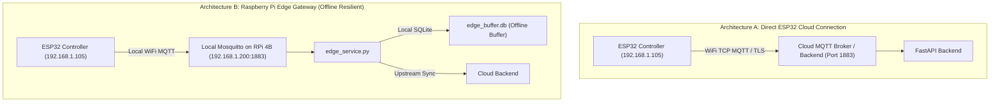

# 03 — IoT Hardware, Firmware & Edge Communication Architecture

**Project**: SmartIrrigate — vel greenish  
**Repository**: `Dhanush-D136/greenishai`  
**Investigation Date**: October 2026  
**Auditor**: Senior IoT Systems Engineer & Embedded Systems Architect  

---

## 1. Physical Hardware & Sensor Inventory

All pinouts, electrical interfaces, and calibration constants below are verified directly from [`firmware/esp32/smartirrigate_esp32.ino`](file:///c:/Users/User/Desktop/SmartIrrigate/firmware/esp32/smartirrigate_esp32.ino) and [`edge/raspberry_pi/edge_service.py`](file:///c:/Users/User/Desktop/SmartIrrigate/edge/raspberry_pi/edge_service.py).

| Component | Physical Model / Specification | Purpose | Interface / Pinout | Verified Source File | Implementation Status |
| :--- | :--- | :--- | :--- | :--- | :--- |
| **Field Microcontroller** | **ESP32 DevKit V1** (30-pin, Xtensa dual-core 240MHz, 2.4GHz Wi-Fi) | Reads sensors, executes local watchdog, controls relay | Micro-USB / 3.3V Logic | `firmware/esp32/smartirrigate_esp32.ino:4-14` | **Implemented & Verified** |
| **Edge Gateway** | **Raspberry Pi 4B** (Broadcom BCM2711, 4GB RAM, Linux OS) | Local MQTT broker, autonomous offline rule evaluation, SQLite buffer | Ethernet / Wi-Fi / USB | `edge/raspberry_pi/edge_service.py:1-40` | **Implemented & Verified** |
| **Soil Moisture Sensor** | **Capacitive Soil Moisture Sensor v1.2** (Corrosion resistant) | Measures volumetric soil water content | **GPIO 34** (ADC1_CH6, Analog input) | `smartirrigate_esp32.ino:22` | **Implemented & Verified** |
| **Ambient Light Sensor** | **LDR (Light Dependent Resistor)** in voltage divider circuit | Measures ambient daylight intensity for watering restrictions | **GPIO 35** (ADC1_CH7, Analog input) | `smartirrigate_esp32.ino:23` | **Implemented & Verified** |
| **Precipitation Sensor** | **FC-37 Rain Droplet Board** with LM393 comparator | Detects active rain to pause watering | **GPIO 32** (Digital input, Active LOW with internal pullup) | `smartirrigate_esp32.ino:24` | **Implemented & Verified** |
| **Temp & Humidity Sensor**| **DHT22 (AM2302)** Digital Sensor | Measures ambient temperature and air humidity | **GPIO 4** (Single-bus digital data) | `smartirrigate_esp32.ino:25,30` | **Implemented & Verified** |
| **Pump Actuator Driver** | **5V Optocoupled Relay Module** (or MOSFET switch) | Switches power to 12V submersible DC pump | **GPIO 23** (Digital output, Active HIGH) | `smartirrigate_esp32.ino:26` | **Implemented & Verified** |
| **Onboard Diagnostic LED**| **Built-in Blue LED** on ESP32 | Blinks on Wi-Fi search, solid ON when connected | **GPIO 2** (Digital output) | `smartirrigate_esp32.ino:27` | **Implemented & Verified** |
| **Water Pump** | **12V DC Submersible Mini Water Pump** | Delivers pressurized water to planter micro-drip emitters | Driven via Relay NO contacts & external 12V DC adapter | `smartirrigate_esp32.ino:211` | **Implemented & Verified** |

---

## 2. Sensor Calibration & Analog Processing Logic

### A. Capacitive Soil Moisture Linear Calibration
Capacitive soil sensors output raw analog ADC voltage readings that decrease as moisture increases. On the ESP32 (12-bit ADC, 0–4095 range):
- **Sensor Suspended in Dry Air**: `SOIL_DRY_RAW = 3200` (represents 0.0% volumetric moisture).
- **Sensor Submerged in Water Cup**: `SOIL_WET_RAW = 1400` (represents 100.0% volumetric moisture).

The calibration formula implemented in [`firmware/esp32/smartirrigate_esp32.ino:235-241`](file:///c:/Users/User/Desktop/SmartIrrigate/firmware/esp32/smartirrigate_esp32.ino#L235-L241) is:

$$\text{Moisture}_{\%} = \left( \frac{\text{SOIL\_DRY\_RAW} - \text{RAW}_{\text{reading}}}{\text{SOIL\_DRY\_RAW} - \text{SOIL\_WET\_RAW}} \right) \times 100$$

Clamped to strict limits $[0.0\%, 100.0\%]$:
```cpp
float readCalibratedSoilMoisture(int rawValue) {
  float percent = (float)(SOIL_DRY_RAW - rawValue) / (float)(SOIL_DRY_RAW - SOIL_WET_RAW) * 100.0;
  if (percent < 0.0) percent = 0.0;
  if (percent > 100.0) percent = 100.0;
  return percent;
}
```

### B. 8-Sample Analog ADC Smoothing Filter
To eliminate high-frequency electromagnetic noise from nearby power lines and the switching motor relay, the firmware performs an 8-sample oversampled moving average before computing moisture (`smartirrigate_esp32.ino:244-250`):
```cpp
long soilRawSum = 0;
for (int i = 0; i < 8; i++) {
  soilRawSum += analogRead(PIN_SOIL_ADC);
  delay(5);
}
int soilRaw = soilRawSum / 8;
```

---

## 3. Dual Hardware Connection Architectures

SmartIrrigate provides two distinct physical connection paths, switchable dynamically from the UI ([`frontend/src/components/DeviceConnectionSection.tsx`](file:///c:/Users/User/Desktop/SmartIrrigate/frontend/src/components/DeviceConnectionSection.tsx)):



### Comparison: Direct ESP32 vs. Raspberry Pi Edge Gateway

| Property | Direct ESP32 Cloud Architecture | Raspberry Pi 4B Edge Gateway Architecture |
| :--- | :--- | :--- |
| **Component Cost** | Extremely low (ESP32 only, ~$5) | Higher (adds RPi 4B, ~$45-$60) |
| **Deployment Complexity**| Low (Direct flash and connect to Wi-Fi) | Medium (requires setting up Linux service & Mosquitto) |
| **Internet Outage Behavior**| Pump shuts off or relies solely on local hardware timer | **Fully Autonomous**: RPi evaluates rules, buffers readings in SQLite |
| **Data Loss Prevention** | Telemetry during internet dropouts is lost | Zero data loss: telemetry queued locally and synced upstream |
| **Security Surface** | ESP32 directly exposes Wi-Fi credentials | Field sensors isolated on local private IoT subnet |

---

## 4. MQTT Protocol & Topic Topology

Both architectures adhere to a unified topic schema standardized in [`firmware/esp32/smartirrigate_esp32.ino`](file:///c:/Users/User/Desktop/SmartIrrigate/firmware/esp32/smartirrigate_esp32.ino) and [`backend/app/services/mqtt_service.py`](file:///c:/Users/User/Desktop/SmartIrrigate/backend/app/services/mqtt_service.py):

| Topic Template | Direction | QoS | Retained | Payload Structure | Purpose |
| :--- | :--- | :--- | :--- | :--- | :--- |
| `smartirrigate/{device_id}/telemetry` | ESP32 ➔ Broker | 1 | `false` | `{"device_id": str, "sequence": int, "soil_moisture_percent": float, "temperature_c": float, "humidity_percent": float, "light_raw": int, "rain_detected": bool, "pump_state": str}` | Transmits sensor measurements every 10 seconds |
| `smartirrigate/{device_id}/commands` | Backend/RPi ➔ ESP32 | 1 | `false` | `{"command_id": str, "action": "START_PUMP"\|"STOP_PUMP"\|"EMERGENCY_STOP", "issued_at": str, "expires_at": str}` | Sends actuation instructions to the field controller |
| `smartirrigate/{device_id}/command-ack` | ESP32 ➔ Broker | 1 | `true` | `{"command_id": str, "device_id": str, "status": "ACKNOWLEDGED", "confirmed_pump_state": "ON"\|"OFF", "timestamp": int}` | Confirms physical relay transition and closes handshake |
| `smartirrigate/{device_id}/status` | ESP32/RPi ➔ Broker | 1 | `true` | `{"device_id": str, "uptime_seconds": int, "signal_strength": int, "firmware_version": str, "ip_address": str}` | Heartbeat monitoring and network diagnostics |

---

## 5. Pump Safety Interlocks & Hardware Safeguards

Safety is the highest priority in automated irrigation to prevent pump burnout, electrical fire, or crop root drowning. The implementation enforces **5 distinct hardware and software safety layers**:

```
Layer 1: Boot-time Relay Grounding (Firmware GPIO 23 LOW on boot)
   ↓
Layer 2: ESP32 Hardware Watchdog Timer (LOCAL_MAX_RUNTIME_MS = 300,000ms / 5 min cutoff)
   ↓
Layer 3: 3-Stage Closed-Loop Command Acknowledgement Handshake (Sent -> Ack -> Confirmed)
   ↓
Layer 4: Continuous Runtime Watchdog in Rule Engine (Max 300s software interlock)
   ↓
Layer 5: Sensor Failsafe Cutoff (Halts pump if sensor reading drops to < 0% or > 100%)
```

### Detailed Safety Mechanisms in Source Code:
1. **Boot-Time Relay Grounding** ([`smartirrigate_esp32.ino:92-95`](file:///c:/Users/User/Desktop/SmartIrrigate/firmware/esp32/smartirrigate_esp32.ino#L92-L95)):
   Upon power restoration, microcontrollers can float pins high. The firmware explicitly drives GPIO 23 `LOW` before Wi-Fi or MQTT initialization:
   ```cpp
   pinMode(PIN_PUMP_RELAY, OUTPUT);
   digitalWrite(PIN_PUMP_RELAY, LOW);
   isPumpRunning = false;
   ```
2. **Local Hardware Watchdog Timer** ([`smartirrigate_esp32.ino:119-123`](file:///c:/Users/User/Desktop/SmartIrrigate/firmware/esp32/smartirrigate_esp32.ino#L119-L123)):
   Even if Wi-Fi disconnects, the cloud backend crashes, or the MQTT broker halts, the ESP32 main `loop()` continuously monitors elapsed runtime. If `millis() - pumpStartedTimestamp >= 300000` (5 minutes), the ESP32 autonomously forces the relay `LOW` without requiring external commands:
   ```cpp
   if (isPumpRunning && (currentMillis - pumpStartedTimestamp >= LOCAL_MAX_RUNTIME_MS)) {
     Serial.println("[SAFETY WATCHDOG] Maximum continuous pump runtime exceeded! Forcing pump OFF.");
     setPumpState(false, "SAFETY_MAX_RUNTIME_EXCEEDED");
   }
   ```
3. **Sensor Validity Failsafe** ([`irrigation_engine.py:73-88`](file:///c:/Users/User/Desktop/SmartIrrigate/backend/app/services/irrigation_engine.py#L73-L88)):
   If an animal chews the sensor wire or the capacitive plate corrodes, the analog value drops outside $[0\%, 100\%]$. The engine immediately dispatches a `STOP` command and raises a `CRITICAL` alert (`INVALID_SENSOR_DATA`).
4. **Mandatory Cooldown Period** ([`irrigation_engine.py:127-138`](file:///c:/Users/User/Desktop/SmartIrrigate/backend/app/services/irrigation_engine.py#L127-L138)):
   Enforces a 30-minute rest period (`cooldown_minutes = 30`) after every watering cycle to allow water to percolate to root depth, avoiding false re-triggering.
5. **Mode-Switch Disarm** ([`state_manager.py:63-66`](file:///c:/Users/User/Desktop/SmartIrrigate/backend/app/services/state_manager.py#L63-L66)):
   Switching operating modes (Simulation ➔ Hardware) or changing connection modes immediately stops any active pump before state transition.

