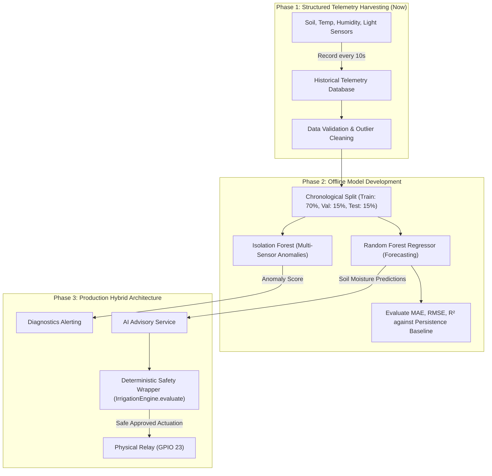

# 04 — Complete AI/ML Model Audit & Algorithmic Analysis

**Project**: SmartIrrigate — vel greenish  
**Repository**: `Dhanush-D136/greenishai`  
**Investigation Date**: October 2026  
**Auditor**: Senior AI/ML Engineer & Systems Architect  

---

## 1. Executive Summary & Audit Methodology

A rigorous, evidence-based investigation was conducted across the entire codebase, including dependency manifests ([`backend/requirements.txt`](file:///c:/Users/User/Desktop/SmartIrrigate/backend/requirements.txt), [`frontend/package.json`](file:///c:/Users/User/Desktop/SmartIrrigate/frontend/package.json)), database schemas, route controllers, services, and embedded firmware.

### Core Audit Finding
> [!IMPORTANT]
> **No Machine Learning model artifacts (`.pkl`, `.joblib`, `.onnx`, `.h5`, `.pt`, `.tflite`), training pipelines, or ML libraries (`scikit-learn`, `tensorflow`, `torch`, `xgboost`) currently exist in the repository.**
>
> What the UI and project tagline refer to as **"AI Mode"** is in fact a **deterministic, multi-constraint, rule-based expert system** coupled with an **analytical crop water calculation algorithm**. It is reliable, deterministic, and safe, but it is **not machine learning**.

---

## 2. Complete Model & Algorithm Implementation Matrix

| Model / Algorithm Name | Target Task | File / Relative Path | Library / Provider | Inputs | Outputs | Current Real Status | Codebase Evidence |
| :--- | :--- | :--- | :--- | :--- | :--- | :--- | :--- |
| **Deterministic Irrigation Rule Engine** | Soil moisture thresholding & pump control decisions | `backend/app/services/irrigation_engine.py` | Python Standard Library | `soil_moisture_percent`, `rain_detected`, `light_percent`, `current_pump_state`, `pump_started_at`, thresholds | `EngineDecision(action="START"\|"STOP"\|"HOLD", reason=str, safety_block=str)` | **Implemented & Invoked** | Full implementation in `irrigation_engine.py:20-163`, called by `mqtt_service.py` and `simulation_service.py` |
| **Zone Crop Water Requirement Analyzer** | Calculates zone target moisture & detects plant water incompatibility | `backend/app/api/zones.py:calculate_zone_plan()` | Python Standard Library | Array of `ZonePlant` objects (`water_category`, `desired_moisture_min`, `target_moisture`) | `ZonePlanCalculationResponse` with recommended target, dry threshold, and conflict warning | **Implemented & Invoked** | Implementation in `zones.py:545-616`, invoked by `PlantLayoutDesigner.tsx` |
| **Soil Evaporation & Wetting Simulator** | Mathematical modeling of moisture curves | `backend/app/services/simulation_service.py` | Python (`threading`, `random`) | Active pump state, simulation speed, ambient diurnal temp/humidity | Synthetic sensor telemetry and moisture state trajectory | **Implemented & Invoked** | Implementation in `simulation_service.py:263-350`, runs background loop |
| **Sensor Boundary Anomaly Detector** | Detects open-circuit or broken sensor faults | `backend/app/services/irrigation_engine.py` | Python Standard Library | `soil_moisture_percent` | Safety block `INVALID_SENSOR_DATA` | **Implemented & Invoked** | Range check `0.0 <= soil_moisture_percent <= 100.0` in `irrigation_engine.py:73` |
| **Random Forest Soil Moisture Forecaster** | 6-hour ahead predictive soil moisture forecasting | *N/A (Candidate Model)* | Planned: `scikit-learn` | Past 24h soil moisture, temperature, humidity, light, solar irradiance | Predicted soil moisture (%) at $t+1h, t+3h, t+6h$ | **Planned / Proposed Only** | Not found in code or dependencies |
| **Isolation Forest Sensor Anomaly Detector** | Multivariate anomaly & drift detection | *N/A (Candidate Model)* | Planned: `scikit-learn` | Vector of `[moisture, temp, humidity, light, d(moisture)/dt]` | Anomaly score $[-1.0, 1.0]$ | **Planned / Proposed Only** | Not found in code or dependencies |
| **Natural Language Advisory Chatbot** | Conversational farm guidance | *N/A (Candidate Feature)* | Planned: Cloud LLM API | Farmer text query, current zone telemetry, weather forecast | Natural language response | **Planned / Proposed Only** | Not found in code or dependencies |

---

## 3. In-Depth Analysis of Implemented Algorithms

### A. The Deterministic Rule Engine (`IrrigationEngine.evaluate`)
- **File**: [`backend/app/services/irrigation_engine.py:20-163`](file:///c:/Users/User/Desktop/SmartIrrigate/backend/app/services/irrigation_engine.py#L20-L163)
- **Design Pattern**: Pure Static Deterministic Function. It has no side effects, making it mathematically verifiable and testable.
- **Decision Workflow**:
  ```mermaid
  flowchart TD
      Start([Telemetry Ingested]) --> Step1{Pump is ON & Runtime >= Max?}
      Step1 -- Yes --> StopMax[STOP: Max Runtime Exceeded]
      Step1 -- No --> Step2{Auto Mode Enabled?}
      Step2 -- No --> HoldManual[HOLD: Auto Mode Disabled]
      Step2 -- Yes --> Step3{Sensor in Range 0% - 100%?}
      Step3 -- No --> StopSensor[STOP / HOLD: Sensor Fault]
      Step3 -- Yes --> Step4{Pump is Currently ON?}
      
      Step4 -- Yes --> Step5{Moisture >= Target?}
      Step5 -- Yes --> StopTarget[STOP: Target Moisture Reached]
      Step5 -- No --> Step6{Rain Detected & Rain Pause?}
      Step6 -- Yes --> StopRain[STOP: Rain Detected]
      Step6 -- No --> HoldWatering[HOLD: Continue Watering]
      
      Step4 -- No --> Step7{Moisture < Dry Threshold?}
      Step7 -- No --> HoldBuffer[HOLD: Optimal Hysteresis Zone]
      Step7 -- Yes --> Step8{Rain Detected & Rain Pause?}
      Step8 -- Yes --> HoldRain[HOLD: Soil Dry but Raining]
      Step8 -- No --> Step9{Cooldown Active?}
      Step9 -- Yes --> HoldCooldown[HOLD: Waiting for Cooldown]
      Step9 -- No --> Step10{Night Restriction Active?}
      Step10 -- Yes --> HoldNight[HOLD: Waiting for Daylight]
      Step10 -- No --> StartPump[START: All Checks Passed]
  ```

### B. Zone Water Plan & Conflict Detection Algorithm
- **File**: [`backend/app/api/zones.py:545-616`](file:///c:/Users/User/Desktop/SmartIrrigate/backend/app/api/zones.py#L545-L616)
- **Problem Solved**: When multiple crops share a single irrigation zone (e.g., tomatoes, lettuce, rosemary), what should the threshold be?
- **Mathematical Formulation**:
  Let $P = \{p_1, p_2, \dots, p_n\}$ be the set of plants in zone $Z$.
  $$\text{Target}_{\text{avg}} = \frac{1}{n} \sum_{i=1}^{n} \text{Target}(p_i)$$
  $$\text{Min}_{\text{avg}} = \frac{1}{n} \sum_{i=1}^{n} \text{MinDesired}(p_i)$$
  $$\text{Calculated Dry Threshold} = \max(15.0, \min(\text{Min}_{\text{avg}}, \text{Target}_{\text{avg}} - 15.0))$$
  $$\text{Calculated Target Moisture} = \max(\text{Dry Threshold} + 10.0, \text{Target}_{\text{avg}})$$
- **Contention / Conflict Detection Logic**:
  ```python
  has_conflict = len(high_plants) > 0 and len(low_plants) > 0
  ```
  If true, generates a domain-informed agricultural alert warning the farmer that high-water crops (e.g., Lettuce) and drought-tolerant succulents/herbs (e.g., Rosemary, Cactus) cannot share a single submersible pump without risking root rot or drought stress.

---

## 4. Architectural Comparison: Rule-Based vs. Machine Learning

To prepare for technical interviews and project defense, the following table evaluates the candidate AI models against the existing implementation:

| Assessment Dimension | Existing Rule-Based Expert Engine | Random Forest Regressor (Soil Forecasting) | Isolation Forest (Anomaly Detection) | Cloud LLM (Chatbot) |
| :--- | :--- | :--- | :--- | :--- |
| **Computational Footprint** | Microscopic (< 0.1ms execution, 0MB RAM) | Low (< 5ms inference, ~15MB RAM) | Low (< 5ms inference, ~10MB RAM) | None locally (External API call) |
| **Execution Location** | ESP32, Raspberry Pi, or Cloud | Raspberry Pi or Cloud Backend | Raspberry Pi or Cloud Backend | External Cloud Provider (e.g., Google Gemini) |
| **Offline Reliability** | **100% Offline Capable** (Runs on RPi/ESP32) | High (Runs locally on RPi) | High (Runs locally on RPi) | Zero (Fails completely without internet) |
| **Data Requirements** | Zero historical data needed | Minimum 30–90 days of continuous telemetry | Minimum 14–30 days of uncorrupted sensor logs | Pre-trained by cloud vendor |
| **Interpretability / Explainability** | **100% Deterministic & Auditable** | Moderate (Feature importance plots) | Low (Contour distance in feature space) | Very Low (Black-box probabilistic output) |
| **Safety in Actuator Control** | **Guaranteed Safe**: Hard bounded limits | **Unsafe alone**: Cannot guarantee against runaway | **Informational only**: Flags warnings | **Unsafe for Direct Control**: Must never touch relay directly |
| **Suitability for Current Project** | **Already working & verified** | Highly recommended as a secondary feature | Recommended for sensor degradation | Optional bonus for educational chat |

---

## 5. Recommended Future AI/ML Roadmap for SmartIrrigate



### Specific Recommendations:
1. **Never Replace the Rule Engine with an ML Model**:
   Always retain [`IrrigationEngine.evaluate()`](file:///c:/Users/User/Desktop/SmartIrrigate/backend/app/services/irrigation_engine.py) as a **supervisory safety wrapper**. Even if an ML model predicts that soil will dry in 2 hours, the physical pump must still obey the 5-minute maximum continuous runtime cutoff, rain pause, and cooldown limits.
2. **Collect 60 Days of Real Sensor Telemetry**:
   Before training a Random Forest model, gather time-series data covering daylight/night oscillations and actual irrigation cycles.
3. **Establish a Persistence Baseline**:
   Any predictive ML model must be benchmarked against the simple persistence baseline:
   $$\hat{y}_{t+h} = y_t$$
   Only deploy the ML model if its Root Mean Squared Error (RMSE) significantly improves over the baseline.

