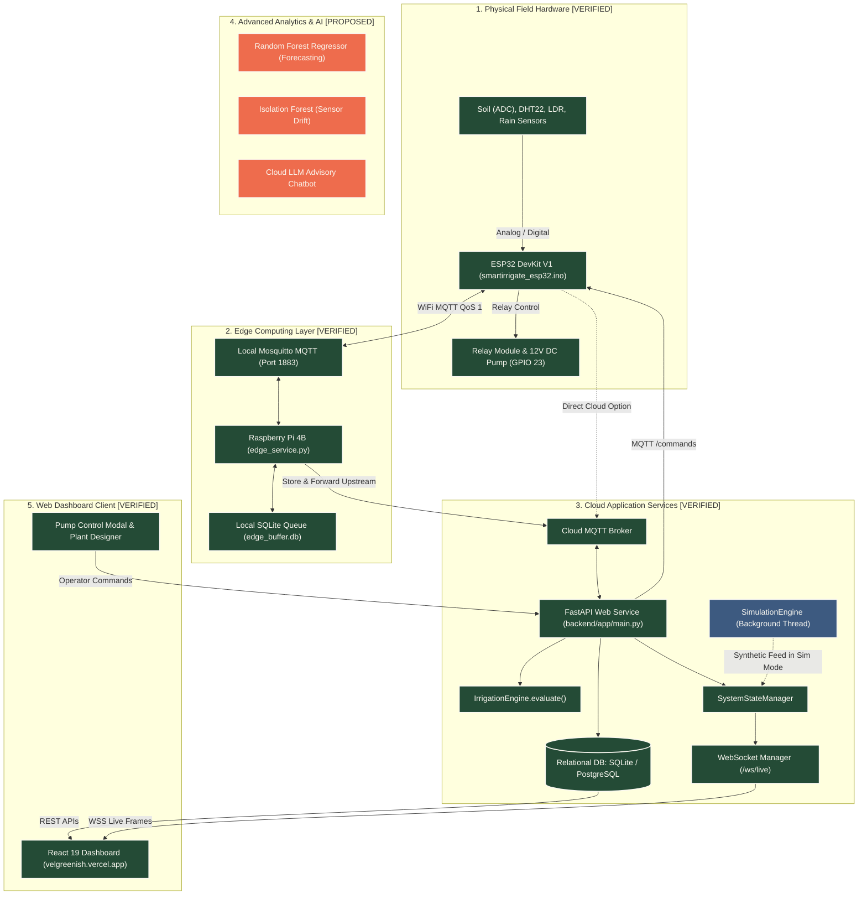

# 07 — Complete End-to-End Data Flow & Lifecycle Specification

**Project**: SmartIrrigate — vel greenish  
**Repository**: `Dhanush-D136/greenishai`  
**Investigation Date**: October 2026  
**Auditor**: Senior Systems Architect & Data Engineer  

---

## 1. System-Wide Architectural Data Flow Diagram



---

## 2. Step-by-Step Data Lifecycle Specification

### Step 1: Physical Sensor Sampling & ADC Processing
- **File**: [`firmware/esp32/smartirrigate_esp32.ino:243-263`](file:///c:/Users/User/Desktop/SmartIrrigate/firmware/esp32/smartirrigate_esp32.ino#L243-L263)
- **Protocol**: Onboard ADC1 and single-bus GPIO digital sampling.
- **Timing**: Every 10,000ms (`TELEMETRY_INTERVAL_MS = 10000`).
- **Processing**:
  1. Soil moisture: 8 successive readings averaged on GPIO 34, linear calibration applied:
     $$\text{Moisture} = \frac{3200 - \text{Raw}}{3200 - 1400} \times 100$$
  2. Temperature & Humidity: read from DHT22 via digital pin 4.
  3. Ambient Light: analog read on GPIO 35.
  4. Rain Detection: digital read on GPIO 32 (Active LOW: `LOW = Rain Detected`).

### Step 2: Microcontroller Telemetry Serialization & Publication
- **File**: [`smartirrigate_esp32.ino:264-281`](file:///c:/Users/User/Desktop/SmartIrrigate/firmware/esp32/smartirrigate_esp32.ino#L264-L281)
- **Protocol**: MQTT v3.1.1 over TCP port 1883.
- **Topic**: `smartirrigate/esp32-zone-01/telemetry` (QoS 1).
- **Payload Format (JSON)**:
  ```json
  {
    "device_id": "esp32-zone-01",
    "sequence": 142,
    "soil_moisture_raw": 2450,
    "soil_moisture_percent": 41.7,
    "temperature_c": 26.4,
    "humidity_percent": 68.2,
    "light_raw": 2180,
    "rain_detected": false,
    "pump_state": "OFF",
    "is_simulated": false
  }
  ```

### Step 3: Edge Ingestion & Autonomous Offline Decision
- **File**: [`edge/raspberry_pi/edge_service.py:110-176`](file:///c:/Users/User/Desktop/SmartIrrigate/edge/raspberry_pi/edge_service.py#L110-L176)
- **Action**:
  1. Local Mosquitto delivers message to `handle_telemetry()`.
  2. Stores reading in `offline_telemetry` table in `edge_buffer.db`.
  3. Evaluates local rules (`evaluate_local_rules`):
     - If `soil_moisture_percent < 35.0%` AND not raining AND cooldown satisfied ➔ Publishes `START_PUMP` directly to `smartirrigate/esp32-zone-01/commands`.
     - Operates completely independently even if upstream WAN is down!

### Step 4: Cloud Ingestion, Persistence & WebSocket Broadcasting
- **File**: [`backend/app/services/mqtt_service.py:112-210`](file:///c:/Users/User/Desktop/SmartIrrigate/backend/app/services/mqtt_service.py#L112-L210)
- **Action**:
  1. Inserts record into database table `sensor_readings`.
  2. Updates `devices` table with `status = "ONLINE"` and `last_seen = now`.
  3. Invokes `IrrigationEngine.evaluate()`.
  4. Dispatches WebSocket frame to all connected browsers via `ws_manager.broadcast()`:
     ```json
     {
       "type": "TELEMETRY_UPDATE",
       "device_id": "esp32-zone-01",
       "soil_moisture_percent": 41.7,
       "temperature_c": 26.4,
       "pump_state": "OFF",
       "timestamp": "2026-10-29T05:30:00Z"
     }
     ```

### Step 5: Dashboard Presentation & Human-in-the-Loop Interaction
- **File**: [`frontend/src/pages/DashboardPage.tsx`](file:///c:/Users/User/Desktop/SmartIrrigate/frontend/src/pages/DashboardPage.tsx) and [`PumpControlModal.tsx`](file:///c:/Users/User/Desktop/SmartIrrigate/frontend/src/components/PumpControlModal.tsx)
- **Rendering**:
  - Live metric cards update instantaneously from WebSocket frames.
  - Recharts Area Chart plots telemetry trajectory.
  - If in `ASK_BEFORE_ACTION` permission mode: an action card prompts the operator to approve or reject proposed irrigation.
  - If operator clicks "Start Pump": opens `PumpControlModal` with duration selection (e.g. 5 mins).

### Step 6: Closed-Loop Actuator Command & Handshake
- **File**: [`backend/app/services/state_manager.py:130-195`](file:///c:/Users/User/Desktop/SmartIrrigate/backend/app/services/state_manager.py#L130-L195)
- **Execution**:
  1. FastAPI creates `IrrigationCommand` record:
     - `command_id = "550e8400-e29b-41d4-a716-446655440000"`
     - `status = "SENT"`, `expires_at = now + 15s`
  2. MQTT service publishes to `smartirrigate/esp32-zone-01/commands`:
     ```json
     {
       "command_id": "550e8400-e29b-41d4-a716-446655440000",
       "action": "START_PUMP",
       "parameters": {"duration_seconds": 300},
       "issued_at": "2026-10-29T05:30:10Z"
     }
     ```
  3. ESP32 receives command in `mqttCallback()`:
     - Asserts `digitalWrite(PIN_PUMP_RELAY, HIGH)` (Relay energizes, motor turns ON).
     - Records `pumpStartedTimestamp = millis()`.
  4. ESP32 immediately publishes confirmation to `smartirrigate/esp32-zone-01/command-ack`:
     ```json
     {
       "command_id": "550e8400-e29b-41d4-a716-446655440000",
       "device_id": "esp32-zone-01",
       "status": "ACKNOWLEDGED",
       "confirmed_pump_state": "ON",
       "reason": "MANUAL_REMOTE_CMD"
     }
     ```
  5. Cloud backend marks command `status = "ACKNOWLEDGED"`, sets authoritative pump state to `RUNNING`, and broadcasts live state to UI.
  6. UI turns pump card into active animated green state: **"State Confirmed: Pumping"**.

